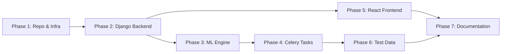

# AequiLens – Iron Deficiency Anemia Detection System

## Detailed Implementation Plan

> **Project**: Full-stack, multimodal ML application for Iron Deficiency Anemia Detection
> **Root Directory**: `anemia_detection_system` (inside `AequiLens`)
> **Created**: 2026-11-06

---

## Plan Overview

| Phase | Title | Sub-Phases | Estimated Files |
|-------|-------|------------|-----------------|
| 1 | Repository Initialization & Infrastructure Setup | 5 | 4 |
| 2 | Django Backend & API Construction | 6 | 7 |
| 3 | Multimodal Machine Learning Engine | 5 | 4 |
| 4 | Celery Task Integration | 3 | 3 |
| 5 | React Frontend Construction | 6 | 7 |
| 6 | Test Data Generation & Database Ingestion | 4 | 4 |
| 7 | Final Wiring & Documentation | 2 | 1 |

---

## Phase 1: Repository Initialization & Infrastructure Setup

**Objective**: Establish the workspace, container orchestration, and dependency management.

| Sub-Phase | ID | Task | Details | Output Files |
|-----------|----|------|---------|-------------|
| 1.1 | P1-S1 | Create root directory | Create `anemia_detection_system/` directory inside the AequiLens workspace | `anemia_detection_system/` |
| 1.2 | P1-S2 | Initialize Git repository | Run `git init` inside the root directory | `.git/` |
| 1.3 | P1-S3 | Create Docker Compose file | Define `postgres` service (postgres:15-alpine, port 5432, env vars: `POSTGRES_USER=anemia_user`, `POSTGRES_PASSWORD=anemia_pass`, `POSTGRES_DB=anemia_db`, named volume `postgres_data` → `/var/lib/postgresql/data`). Define `redis` service (redis:7-alpine, port 6379). | `docker-compose.yml` |
| 1.4 | P1-S4 | Create backend directory & dependencies | Create `backend/` directory. Create `requirements.txt` with pinned libraries: Django≥4.2, djangorestframework≥3.14, django-cors-headers≥4.2, psycopg2-binary≥2.9, celery≥5.3, redis≥5.0, torch≥2.0, torchvision≥0.15, opencv-python-headless≥4.8, Pillow≥10.0, numpy≥1.24, scikit-learn≥1.3 | `backend/requirements.txt` |
| 1.5 | P1-S5 | Create frontend directory placeholder | Create `frontend/` directory (full initialization deferred to Phase 5) | `frontend/` |

---

## Phase 2: Django Backend & API Construction

**Objective**: Set up the Django API, database schema, and file handling.

| Sub-Phase | ID | Task | Details | Output Files |
|-----------|----|------|---------|-------------|
| 2.1 | P2-S1 | Initialize Django project | Run `django-admin startproject core .` inside `backend/` | `backend/core/__init__.py`, `backend/core/settings.py`, `backend/core/urls.py`, `backend/core/wsgi.py`, `backend/core/asgi.py`, `backend/manage.py` |
| 2.2 | P2-S2 | Create API app | Run `python manage.py startapp api` inside `backend/` | `backend/api/` (models.py, views.py, admin.py, apps.py, tests.py, migrations/) |
| 2.3 | P2-S3 | Configure Django settings | **INSTALLED_APPS**: Add `'api'`, `'rest_framework'`, `'corsheaders'`. **MIDDLEWARE**: Insert `'corsheaders.middleware.CorsMiddleware'` at the top. **CORS**: Set `CORS_ALLOW_ALL_ORIGINS = True`. **DATABASE**: Switch to PostgreSQL engine with Phase 1 credentials (`anemia_user` / `anemia_pass` / `anemia_db`, host `localhost`, port `5432`). **Celery**: `CELERY_BROKER_URL = 'redis://localhost:6379/0'`, `CELERY_RESULT_BACKEND = 'redis://localhost:6379/0'`. **Media**: `MEDIA_URL = '/media/'`, `MEDIA_ROOT = os.path.join(BASE_DIR, 'media')` | `backend/core/settings.py` |
| 2.4 | P2-S4 | Define database schema | Create `PatientRecord` model with fields: `id` (UUIDField, pk), `patient_id` (CharField, max_length=100, db_index), `sample_id` (CharField, max_length=100, db_index), `conjunctiva_img` (ImageField, upload_to='images/conjunctiva/'), `fingernail_img` (ImageField, upload_to='images/fingernails/'), `diagnosis_codes` (JSONField, default=list), `symptoms` (TextField), `risk_score` (FloatField, null, blank), `status` (CharField, max_length=20, choices: PENDING/PROCESSING/COMPLETED/FAILED, default=PENDING), `created_at` (DateTimeField, auto_now_add) | `backend/api/models.py` |
| 2.5 | P2-S5 | Build API layer (serializer + viewset) | **Serializer**: `PatientRecordSerializer(ModelSerializer)` — include all fields, make `risk_score` and `status` read-only. **ViewSet**: `PatientRecordViewSet(ModelViewSet)` — define queryset & serializer_class. Override `perform_create`: save instance, import Celery task `predict_anemia_risk`, call `.delay(str(instance.id))`, update instance status to `'PROCESSING'`. | `backend/api/serializers.py`, `backend/api/views.py` |
| 2.6 | P2-S6 | Configure URL routing | Register ViewSet with `DefaultRouter`. Append `static(settings.MEDIA_URL, document_root=settings.MEDIA_ROOT)` to URL patterns. | `backend/core/urls.py` |

---

## Phase 3: Multimodal Machine Learning Engine

**Objective**: Define the preprocessing logic and PyTorch multimodal architecture.

| Sub-Phase | ID | Task | Details | Output Files |
|-----------|----|------|---------|-------------|
| 3.1 | P3-S1 | Create ML engine directory | Create `backend/api/ml_engine/` with `__init__.py` | `backend/api/ml_engine/__init__.py` |
| 3.2 | P3-S2 | Image preprocessing | `process_image(image_path)`: Open with PIL, apply torchvision transforms (Resize 224×224, ToTensor, Normalize with ImageNet means/stds), add batch dimension `.unsqueeze(0)`. Return tensor of shape `(1, 3, 224, 224)`. | `backend/api/ml_engine/preprocess.py` |
| 3.3 | P3-S3 | Clinical data preprocessing | `process_clinical_data(diagnosis_list, symptoms_text)`: Placeholder function that outputs a tensor of shape `(1, 128)`. Can use simple hashing / random seeded encoding for deterministic output. | `backend/api/ml_engine/preprocess.py` (same file as 3.2) |
| 3.4 | P3-S4 | Model architecture | `AnemiaMultimodalNet(nn.Module)`: **Image branches** — Two `resnet50(pretrained=True)` backbones (one for fingernails, one for conjunctiva), strip final FC layers → 2048-d features each. **Tabular branch** — `tabular_mlp`: Linear(128→256)→ReLU→Linear(256→128). **Fusion head** — Concatenate (2048 + 2048 + 128 = 4224-d) → Linear(4224→512)→ReLU→Linear(512→1)→Sigmoid. Output: single probability float. | `backend/api/ml_engine/model.py` |
| 3.5 | P3-S5 | Inference logic | `run_prediction(patient_record_id)`: Query `PatientRecord` from DB, load conjunctiva & fingernail images via `process_image()`, process clinical data via `process_clinical_data()`, instantiate model (or load weights if available), run forward pass with `torch.no_grad()`, return float risk score (0.0–1.0). | `backend/api/ml_engine/predict.py` |

---

## Phase 4: Celery Task Integration

**Objective**: Decouple ML inference from the API request cycle.

| Sub-Phase | ID | Task | Details | Output Files |
|-----------|----|------|---------|-------------|
| 4.1 | P4-S1 | Celery application config | Create Celery app in `core/celery.py`: set `os.environ` for Django settings, create `Celery('core')`, call `config_from_object('django.conf:settings')`, `autodiscover_tasks()`. | `backend/core/celery.py` |
| 4.2 | P4-S2 | Expose Celery in `__init__` | Import Celery app in `core/__init__.py` and set `__all__` so it's available at project level. | `backend/core/__init__.py` |
| 4.3 | P4-S3 | Define prediction task | `@shared_task(bind=True) def predict_anemia_risk(self, record_id)`: In try/except — fetch `PatientRecord`, call `run_prediction(record_id)`, update `risk_score` and `status='COMPLETED'`. On exception — set `status='FAILED'`, log error. | `backend/api/tasks.py` |

---

## Phase 5: React Frontend Construction

**Objective**: Build a dynamic UI with drag-and-drop file support and background polling.

| Sub-Phase | ID | Task | Details | Output Files |
|-----------|----|------|---------|-------------|
| 5.1 | P5-S1 | Initialize Vite + React project | Navigate to `frontend/`, run `npm create vite@latest . --template react` | `frontend/package.json`, `frontend/vite.config.js`, `frontend/index.html`, `frontend/src/` |
| 5.2 | P5-S2 | Install dependencies | `npm install axios react-dropzone tailwindcss postcss autoprefixer lucide-react` | `frontend/package.json` (updated), `frontend/package-lock.json` |
| 5.3 | P5-S3 | Configure Tailwind CSS | Initialize Tailwind (`npx tailwindcss init -p`), configure `content` paths in `tailwind.config.js`, add Tailwind directives to `src/index.css` | `frontend/tailwind.config.js`, `frontend/postcss.config.js`, `frontend/src/index.css` |
| 5.4 | P5-S4 | Build main App component | `src/App.jsx`: Manage state between `UploadForm` and `ResultsDisplay`. Track `recordId` and `currentView` state. Render header, conditional form/results, and footer. | `frontend/src/App.jsx` |
| 5.5 | P5-S5 | Build Upload component | `src/components/UploadForm.jsx`: Text inputs for `patient_id`, `sample_id`, `symptoms`, `diagnosis`. Two separate `useDropzone` areas (conjunctiva image, fingernail image). Submit handler: build `FormData`, POST to `http://localhost:8000/api/records/`, return `recordId` to parent via callback. Loading/error states. | `frontend/src/components/UploadForm.jsx` |
| 5.6 | P5-S6 | Build Results component | `src/components/ResultsDisplay.jsx`: Accept `recordId` as prop. Poll `http://localhost:8000/api/records/${recordId}/` every 3 seconds using `setInterval` + `useEffect`. Render: spinner for PENDING/PROCESSING, error message for FAILED, visual risk gauge (color-coded arc or bar) for COMPLETED with risk score display. Cleanup interval on unmount. | `frontend/src/components/ResultsDisplay.jsx` |

---

## Phase 6: Test Data Generation & Database Ingestion

**Objective**: Create sample multimodal test data and a script to populate the local database for testing.

| Sub-Phase | ID | Task | Details | Output Files |
|-----------|----|------|---------|-------------|
| 6.1 | P6-S1 | Create data directories | Create `backend/test_data/images/conjunctiva/` and `backend/test_data/images/fingernails/` | Directories only |
| 6.2 | P6-S2 | Generate clinical data CSV | Create CSV with columns: `patient_id`, `sample_id`, `icd10_codes`, `symptoms`. Populate with 5 rows of realistic mock data (e.g., P001/S001, P001/S002, P002/S001, P003/S001, P003/S002). Format `icd10_codes` as JSON string (e.g., `["D50.0", "D50.9"]`). | `backend/test_data/clinical_data.csv` |
| 6.3 | P6-S3 | Create dummy image generator script | `backend/scripts/generate_dummy_images.py`: Use PIL to generate 224×224 solid-colored placeholder images with text overlay identifying sample. Read CSV, for each row create `{patient_id}_{sample_id}_conjunctiva.jpg` and `{patient_id}_{sample_id}_fingernail.jpg` in respective `test_data/images/` folders. | `backend/scripts/generate_dummy_images.py` |
| 6.4 | P6-S4 | Create Django ingestion management command | `api/management/commands/ingest_test_data.py`: Custom management command. Read `backend/test_data/clinical_data.csv` with Python `csv` module. For each row: create `PatientRecord` instance, attach matching dummy images using Django's `File` wrapper, call `predict_anemia_risk.delay(record.id)` to simulate pipeline. | `backend/api/management/commands/ingest_test_data.py` |

---

## Phase 7: Final Wiring & Documentation

**Objective**: Ensure the system is reproducible and executable by a human operator.

| Sub-Phase | ID | Task | Details | Output Files |
|-----------|----|------|---------|-------------|
| 7.1 | P7-S1 | Create README.md | Write comprehensive README at repository root with project overview, architecture diagram (text/mermaid), tech stack description, and prerequisites. | `anemia_detection_system/README.md` |
| 7.2 | P7-S2 | Document execution steps | Include explicit step-by-step instructions: **1.** `docker-compose up -d` (start Postgres + Redis). **2.** `cd backend && python manage.py makemigrations && python manage.py migrate`. **3.** Run `python scripts/generate_dummy_images.py` to create test images. **4.** `python manage.py ingest_test_data` to populate DB. **5.** `python manage.py runserver 0.0.0.0:8000` to start backend. **6.** `celery -A core worker --loglevel=info` to start Celery worker. **7.** `cd frontend && npm install && npm run dev` to start frontend. | `anemia_detection_system/README.md` (same file) |

---

## Dependency Graph

> **IMPORTANT**: Each phase will be implemented only after explicit user confirmation. The implementation log (`implementation_log.md`) and model reasoning (`model_reasoning.txt`) will be updated after each sub-phase is completed.

